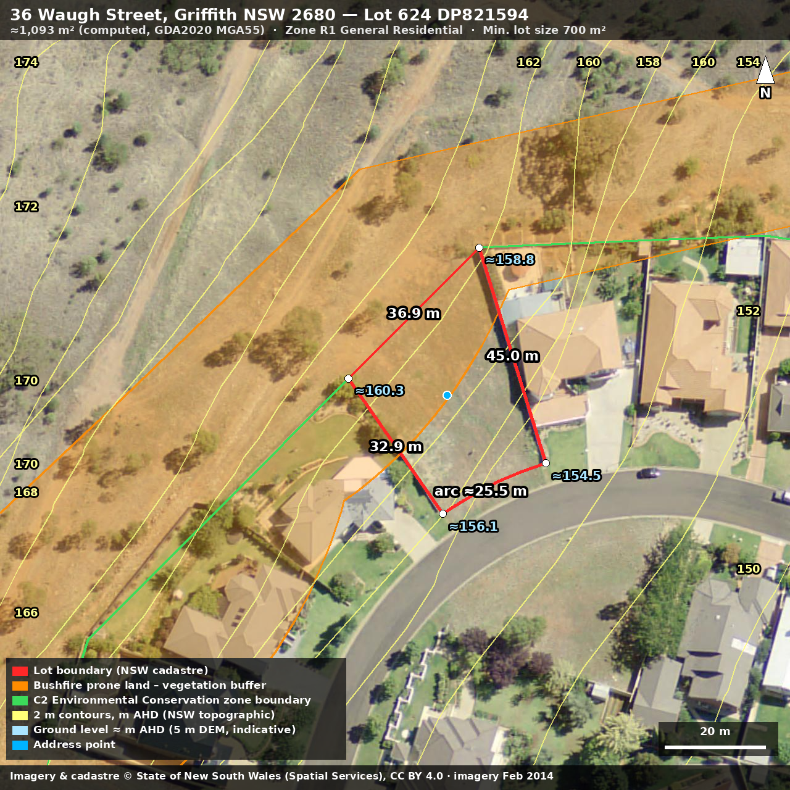
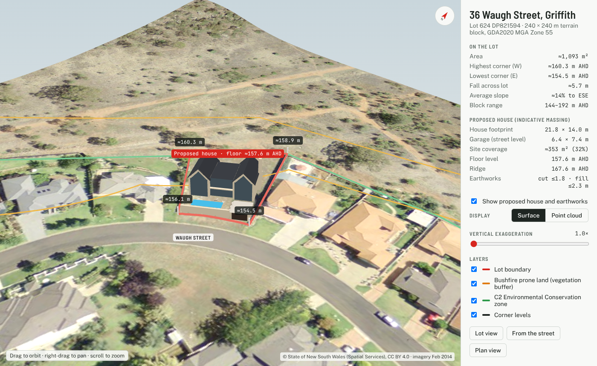
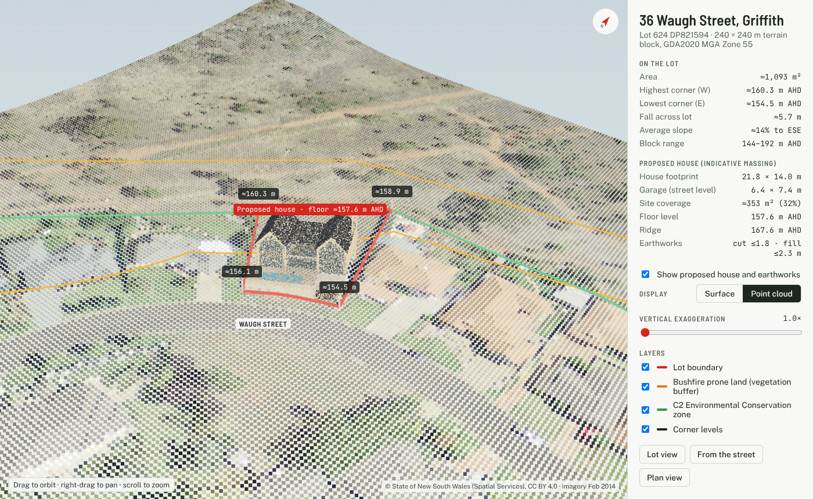

# 36 Waugh Street, Griffith NSW 2680 — site information

Desktop site lookup for a planned house build. Data fetched 12 October 2026 directly from NSW
government ArcGIS REST services (raw responses in `data/`). Coordinates are GDA2020 / WGS84;
areas and lengths are computed in GDA2020 MGA Zone 55 (EPSG:7855).

Imagery and cadastre © State of New South Wales (Spatial Services), licensed CC BY 4.0.

## Title and lot

| Item | Value | Source |
|---|---|---|
| Lot / plan | **Lot 624 DP821594** (`lotidstring` 624//DP821594) | NSW_Cadastre/MapServer/9 (Lot) |
| Address point | 146.077937, −34.264453 (GURAS address 36 WAUGH STREET GRIFFITH, single match) | NSW_Geocoded_Addressing_Theme/MapServer/1 |
| Lot area | **≈1,093 m²** (1,092.8 m² planar MGA55; 1,093.4 m² ellipsoidal) | Computed from the cadastre polygon |
| Perimeter | ≈137.7 m | Computed |
| Boundaries | NW (rear) 36.9 m · NE side 45.0 m · SW side 32.9 m · street frontage a curve of ≈25.5 m | Computed |

The cadastre's own `planlotarea` field is empty and its `shape_Area` (1,604.8) is in Web Mercator
units, which inflate area at this latitude, so neither should be quoted. The computed area comes from the
digital cadastre, which is not survey-accurate; the registered plan DP821594 gives the legal
dimensions and area.

## Planning (Griffith LEP 2014 and SEPPs)

| Control | Result |
|---|---|
| Zoning | **R1 General Residential** across the whole lot (Griffith LEP 2014, Amendment No 7). The rear (NW) boundary adjoins **C2 Environmental Conservation** land (0 m² overlap with the lot). |
| Minimum lot size | **700 m²** (map class 700–749, symbol Q, cl. 4.1) |
| Height of buildings / FSR | No LEP map control applies |
| Heritage | None mapped |
| **Bushfire prone land** | **Yes: Vegetation Buffer** (data updated 30 May 2023). It covers ≈546 m², about half the lot, on the rear/uphill side. Expect a BAL assessment under Planning for Bush Fire Protection. |
| Flood planning | Not mapped |
| Landslide risk, acid sulfate soils, salinity, riparian, biodiversity, wetlands, scenic protection | Not mapped |
| Land reservation acquisition | None |
| DCP | An LGA-based Development Control Plan applies (Griffith) |

Sources: `mapprod3.environment.nsw.gov.au` `Planning/EPI_Primary_Planning_Layers`,
`Planning/Hazard`, `Planning/Protection`, `ePlanning/Planning_Portal_Hazard`,
`ePlanning/Planning_Portal_Local_Provisions` and `ePlanning/Planning_Portal_Development_Control`.
These are NSW Department of Planning services; the Planning Portal host
`mapservices.planningportal.nsw.gov.au` did not respond from this environment (HTTP 502), so it was **not**
used. **Unverified:** results have not been cross-checked against a Planning Portal property report or a
Section 10.7 planning certificate from Griffith City Council. Get the certificate before relying on them.

## Levels (heights)

| Item | Value |
|---|---|
| Ground levels at corners | ≈160.3 (W) · ≈158.8 (N) · ≈154.5 (E, street) · ≈156.1 (S, street) m AHD |
| Range over lot | ≈154.5 to ≈160.2 m AHD, so ≈5.7 m of fall |
| Average slope | ≈14% (≈8°), falling to the east-south-east (toward the street) |
| Wider setting | Contours within 200 m run from 144 to 194 m AHD. The land rises steeply behind the lot into the C2 bushland. |

Levels are sampled from the NSW 5 m DEM (`public/NSW_5M_Elevation/ImageServer`, tile
Griffith-DEM-AHD_55_5m, derived from stereo imagery), resampled to 1 m. The 2 m contours are from
`NSW_Elevation_and_Depth_Theme/MapServer/2`. Both are **indicative only**: the 5 m DEM smooths the
ground and its vertical accuracy is metre-scale. No finer LiDAR product was found through these
services. Get a detail and level survey by a registered surveyor before design.

## 3D terrain model

- **Interactive viewer:** `site_3d.html`, a self-contained page also published as a private artifact. Orbit and zoom, adjust vertical exaggeration (1–4×), switch the overlays on and off, and jump to lot, street or plan views.
- **Point cloud:** `data/3d/site_pointcloud.las`, 230,400 points at 0.5 m spacing over a 240 × 240 m block, coloured from the aerial photo. Coordinates are GDA2020 MGA Zone 55 (EPSG:7855) with heights in m AHD, and the CRS is embedded in the file. It opens in CloudCompare, QGIS and most CAD/BIM tools. `site_pointcloud_local.ply` is the same cloud with local coordinates (origin at E 414993, N 6208020, AHD 0), for MeshLab or Blender.
- **Textured mesh:** `data/3d/site_terrain.glb`, the 1 m terrain surface with the photo draped on. It opens in the Windows 3D Viewer, Blender and SketchUp (via an importer). Local coordinates: x east, y up (m AHD), z south.

### Proposed house (indicative massing)

A two-gable house scaled from the concept image has been fitted to the lot (`scripts/house_massing.py`). These are assumptions for visualisation, not a design:

| Item | Assumed value |
|---|---|
| Layout | Two 7 m wide, two-storey gabled wings with glazed gable ends facing the street, linked by an 8 m flat-roofed centre; chimney on the NE wing |
| House footprint | 21.8 × 14.0 m, set back 10 m from the street chord |
| Garage | 6.4 × 7.4 m at street level (floor 155.0 m AHD) in front of the NE wing, roof forms part of the terrace |
| Ground floor level | 157.6 m AHD; terrace and pool deck 157.45 m AHD behind a stone street wall |
| Eaves / ridge | 6.4 m / 10.0 m above floor (ridge ≈167.6 m AHD) |
| Site coverage | ≈353 m² of 1,093 m² (32%) |
| Earthworks | Pad cut up to ≈1.8 m at the rear (rear retaining wall), fill up to ≈2.3 m at the front |

The cabana in the concept image is left out: with the house in place there isn't room for it across the frontage. Setbacks, coverage, wall heights and BAL construction requirements haven't been checked against the Griffith DCP or Planning for Bush Fire Protection.

- `data/3d/site_with_house.las`: designed ground plus house surfaces (265,350 points). Classes: 2 ground, 6 building, 9 water (pool).
- `data/3d/house_massing.glb`: the house mesh, in the same local frame as `site_terrain.glb`.
- The viewer has a **Show proposed house and earthworks** toggle and a **Surface / Point cloud** switch.

**This is not LiDAR.** The points are interpolated from the NSW 5 m elevation grid, so they show the general fall of the land, not kerbs, banks or trees. A true LiDAR point cloud for Griffith may be available from Geoscience Australia's ELVIS portal (elevation.fsdf.org.au). Downloads there are ordered on the website and delivered by email. The old ELVIS API host `elvis2018-ga.fmecloud.com` no longer exists in DNS, and the new API (`api.elevation.fsdf.org.au`) returned errors when called directly from this environment.

`scripts/build_3d_site.py` builds the point cloud, mesh and viewer data from `data/3d/dem_240m.tif` and the imagery tiles; `scripts/build_3d_viewer.py` bakes `site_3d.html`.

## Imagery

The aerial photo is the NSW_Imagery tile cache at zoom 20, ≈0.12 m/pixel. Per `NSW_Imagery_Dates` it is
the Griffith ADS40 town capture, 10 cm resolution, dated **17 February 2014**. The lot appeared
vacant then; current conditions may differ.

## Reproducing

- `data/` holds the raw GeoJSON/JSON responses, the DEM export (`dem5m_mga.tif`, `dem_crop.npy`) and
  the imagery tiles.
- `scripts/render_site_map.py` redraws `site_aerial.png` from `data/` (requires `pyproj`, `shapely`,
  `numpy`, `Pillow`).
